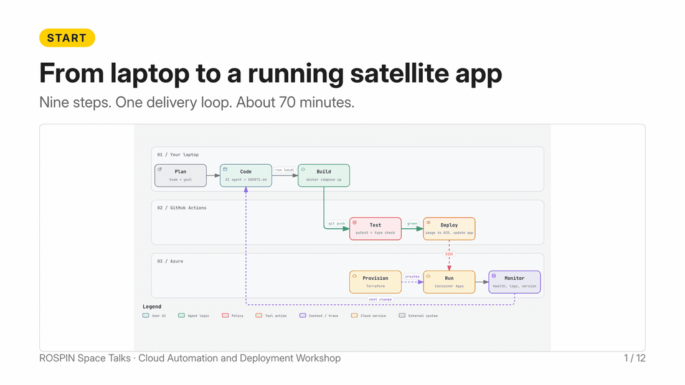

# Cloud workshop: ship a satellite app to Azure

[](LICENSE)


Take a real app from your laptop to a live URL on **Azure Container Apps** in about an hour: Docker, GitHub Actions CI/CD, Terraform and an AI coding agent, with no passwords anywhere. Built for the **ROSPIN Space Talks: Cloud Automation and Deployment Workshop**, usable on its own.



This is the **Infra** repository (Terraform + bootstrap). The app lives in its companion, [ROSPIN_Workshop_Apps](https://github.com/agi1clj/ROSPIN_Workshop_Apps): a vegetation-health (NDVI) explorer for Romanian regions built on Sentinel-2 data. Both are GitHub **template repositories**.

## Start

1. Read the [walkthrough](docs/walkthrough.md) (9 steps: plan, code, build, test, provision, deploy, monitor, iterate, submit), or watch the [narrated tutorial](docs/tutorial.mp4) (5 min).
2. Create your repos, run the bootstrap, deploy:

```bash
gh repo create <team>-rospin-apps  --public --clone --template agi1clj/ROSPIN_Workshop_Apps
gh repo create <team>-rospin-infra --public --clone --template agi1clj/ROSPIN_Workshop_Infra
cd <team>-rospin-infra && ./bootstrap/bootstrap.sh
```

You need: a GitHub account, an Azure for Students subscription (Owner role), Git, Docker Desktop (running), Azure CLI, GitHub CLI and Terraform 1.14+. Install links and checks: the [Before you start](docs/walkthrough.md#before-you-start-do-this-the-day-before-about-30-minutes) list. On Windows use Git Bash, not PowerShell.

## What you build



| Measured on Azure for Students | Time |
|---|---|
| Bootstrap | 2 min |
| First deployment (3 stages) | about 7 min |
| Every later `git push` to live | about 90 s |

Delete everything with `./scripts/cleanup.sh` when you finish: the registry costs money every day.

## Best practices built in

- **No secrets**: GitHub Actions signs in to Azure with OIDC and a managed identity. Containers pull images with `AcrPull`.
- **Terraform**: small modules, remote state with Entra ID auth (no storage keys), `plan` before `apply`, offline `terraform test`, HashiCorp style guide.
- **CI/CD**: tests gate deploys; deploys only from `main`; every image is tagged with its commit and verified through `/health`.
- **AI from day one**: [AGENTS.md](AGENTS.md) plus `CLAUDE.md` and `GEMINI.md`. See [docs/ai-setup.md](docs/ai-setup.md).

## Layout

```
bootstrap/bootstrap.sh                   one-time Azure + GitHub setup
terraform/environments/dev/              root module, state in Azure Storage
terraform/modules/container-registry/    ACR
terraform/modules/container-apps/        environment, identity, backend and frontend apps
.github/workflows/terraform.yml          fmt, validate, test; manual plan + apply
scripts/cleanup.sh                       teardown
docs/                                    walkthrough, architecture, AI setup
```

Checks (no Azure needed): `terraform fmt -check -recursive terraform` and, in `terraform/environments/dev`, `terraform init -backend=false && terraform validate && terraform test`.

## Contributing and license

[Contributing](CONTRIBUTING.md) · [Code of conduct](CODE_OF_CONDUCT.md) · [Security](SECURITY.md) · [MIT license](LICENSE)

## Your deployment (fill in)

- Frontend: <https://...>
- Backend: <https://.../docs>
