# Architecture

## The delivery loop

Each step of [walkthrough.md](walkthrough.md) belongs to one stage of this loop.

## What runs in Azure

| Resource | Created by | Name |
|---|---|---|
| Resource group | Terraform | `rg-rospin-<team>-dev` |
| Container registry (ACR) | Terraform | `acrrospin<team>dev<4 hex>` |
| Container Apps environment | Terraform | `cae-rospin-<team>-dev` |
| Backend and frontend apps | Terraform (image updates by Apps CI) | `rospin-api-<team>-dev-<4 hex>`, `rospin-ui-<team>-dev-<4 hex>` |
| Identity of the apps (pulls images) | Terraform | `id-rospin-<team>-dev-apps` |
| Terraform state storage | `bootstrap.sh` | `rg-rospin-<team>-tfstate` |
| Identity of GitHub Actions (OIDC) | `bootstrap.sh` | `github-actions-rospin-<team>` |

## Who owns what

- **Terraform** owns the infrastructure and every app setting, except the container image.
- **Apps CI** owns the image tag. Terraform ignores `template[0].container[0].image` so a deployment is never rolled back by a plan.
- **No secrets exist.** GitHub signs in with OIDC. The containers pull from ACR with a managed identity (role `AcrPull`).

## Deliberate trade-offs

A security scanner (Checkov) flags the container registry for features that need the Premium tier or private networking: zone redundancy, geo-replication, content trust, quarantine, private endpoints. This workshop uses the Basic tier on purpose: it is cheap and the apps stay reachable. For production, move to Premium and add a private endpoint.

Other choices: one environment (`dev`), public ingress without a custom domain or WAF, no Key Vault because the app has no secrets, no Log Analytics workspace (use `az containerapp logs show`). Each is an easy extension; see `AGENTS.md` for the rules to keep when you add one.

## Security model

| Control | Where |
|---|---|
| No stored credentials: GitHub signs in with OIDC, only `main` of the two repos is trusted | `bootstrap.sh` (federated credentials) |
| Least privilege in CI: workflows have `contents: read`; `id-token: write` only in the deploy jobs; Azure is touched only from `main` and only after tests pass | `.github/workflows/*.yml` |
| `terraform apply` runs only from a manual run of the workflow, on `main`, from a saved plan | `terraform.yml` |
| The GitHub identity has `Contributor` on the subscription (it must create the resource group) and may assign only the `AcrPull` role (ABAC condition) | `bootstrap.sh` |
| Registry admin user off; the apps pull with a managed identity | `container-registry`, `container-apps` |
| State in a private storage account: Entra ID auth only (no keys), TLS 1.2, versioning and 7-day soft delete | `bootstrap.sh` |
| Containers run as non-root, images are patched at build time (`apt-get upgrade`, `apk upgrade`), pip is removed from the backend image | `Dockerfile`s |
| Backend allows only the frontend origin (CORS), validates path input, and rate-limits the expensive live endpoint with a lock and a one-hour cache | `container-apps`, `backend/app` |

Used for this review: gitleaks (no secrets), actionlint, tflint, `terraform validate/test`, shellcheck, Trivy (config and images: 0 fixable high or critical findings), `npm audit` and `pip-audit` (no known vulnerabilities). Workflow actions are pinned to major tags and kept current by Dependabot; pin to commit SHAs for production.
